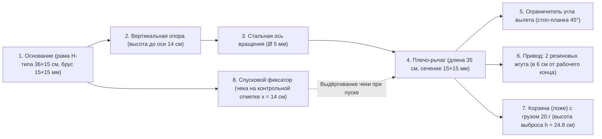

# Домашнее задание: Катапульта «Резиновая» (Отчёт к STEM Олимпиаде)

> [!IMPORTANT]
> **Дедлайн регистрации и сдачи домашнего задания:** до **18:00 22 октября 2026 года** по ссылке из положения (`https://forms.gle/GBvF4si1qwfXwen87`).
> В этом документе собраны **полная инструкция по сборке**, **инженерная спецификация** и **готовый расчётный отчёт** сразу для обеих возрастных категорий (**Категория I: 8–9 классы** и **Категория II: 10–11 классы / колледжи**) по всем критериям жюри (на максимум **100 баллов**).

---

## 1. Название задания
**Катапульта «Резиновая»** — *Конструирование, экспериментальное исследование и анализ дальности полёта груза.*

---

## 2. Цель работы
* **Для Категории I (8–9 классы):** Изучить влияние формы груза (шар, куб, конус, плоский диск) на дальность и стабильность полёта при сохранении одинаковой массы ($m = 20 \pm 1\text{ г}$) и одинаковых условий запуска.
* **Для Категории II (10–11 классы и студенты колледжа):** Исследовать аэродинамику полёта и энергетику запуска груза с помощью рычажной катапульты с резиновым приводом, определить жёсткость привода $k$, запасённую потенциальную энергию $E$ и начальную скорость вылета $v$, а также сравнить теоретическую дальность полёта $L_{\text{теор}}$ (с учётом высоты точки выброса $h$) и экспериментальную дальность $L_{\text{эксп}}$ для объектов четырёх разных форм при равной массе ($20\text{ г}$).

---

## 3. Материалы и оборудование (п. 1.1)

| Элемент / Прибор | Стандартизированное требование по ТЗ | Выбранные параметры нашей модели |
| :--- | :--- | :--- |
| **Основание** | Любой жёсткий материал в форме «П» или «Н», сечение не менее $15 \times 15\text{ мм}$ | Деревянная рама в форме «Н» из брусков $15 \times 15\text{ мм}$, габариты $36 \times 15\text{ см}$ |
| **Опора** | Высота от основания до оси вращения плеча $12\text{–}15\text{ см}$ | Две вертикальные стойки ($15 \times 15\text{ мм}$), высота оси от основания $H = 14{,}0\text{ см}$ |
| **Плечо (рычаг)** | Длина $30\text{–}40\text{ см}$, сечение $15 \times 15\text{ мм}$; крепление резинки в $5\text{–}7\text{ см}$ от рабочего конца | Деревянный брус длиной $35{,}0\text{ см}$, сечением $15 \times 15\text{ мм}$; точка крепления резинки в $6{,}0\text{ см}$ от рабочего края |
| **Ось вращения** | Диаметр $4\text{–}6\text{ мм}$, перпендикулярно плечу через опору | Стальной гладкий стержень (болт/шпилька) диаметром $d_{\text{оси}} = 5{,}0\text{ мм}$ |
| **Привод** | $2$ одинаковых резиновых жгута (сечение $3\text{–}5\text{ мм}$), не меняются весь опыт | $2$ одинаковых резиновых жгута сечением $4\text{ мм}$, рабочий ход растяжения $x = 14{,}0\text{ см}$ ($0{,}14\text{ м}$) |
| **Ограничитель** | Фиксирует угол вылета плеча на отметке $45^\circ$ от горизонтали | Поперечная перекладина впереди опоры, угол вылета $\alpha = 45{,}0^\circ$ (проверен транспортиром) |
| **Корзина (ложе)** | Небольшое углубление или скоба на рабочем конце плеча | Деревянное/пластиковое ложе $3{,}6 \times 3{,}6\text{ см}$ с бортиками $1{,}2\text{ см}$ на рабочем конце |
| **Спусковой фиксатор** | Механический фиксатор (гвоздь/крючок/петля) — **без удержания рукой** | Металлическая чека (крючок с петлёй) на задней перемычке основания на фиксированной отметке |
| **Измерительные приборы** | Весы (точность $\le 1\text{ г}$), рулетка ($\ge 3\text{ м}$), транспортир, секундомер / камера | Электронные весы (точность $0{,}1\text{ г}$), рулетка $5\text{ м}$, транспортир, смартфон ($60/120\text{ fps}$) |
| **Грузы ($4$ формы)** | Пластилин ($\rho \approx 1{,}7\text{–}1{,}8\text{ г/см}^3$), масса каждого $20 \pm 1\text{ г}$ | **Шар** ($\varnothing 2{,}7\text{ см}$), **Куб** (ребро $2{,}2\text{ см}$), **Конус** ($h = 4{,}5\text{ см}, \varnothing 3{,}0\text{ см}$), **Плоский диск** ($\varnothing 4{,}8\text{ см}, h = 0{,}5\text{ см}$) — все ровно по $20{,}0\text{ г}$ |

---

## 4. Схема катапульты и ход работы (п. 1.2–1.3)

### Пошаговое описание сборки и методики измерений:
1. **Сборка основания и опоры:** Две продольные плашки ($36\text{ см}$, сечение $15 \times 15\text{ мм}$) скреплены тремя поперечинами в жёсткую «Н»-образную раму. На расстоянии $12\text{ см}$ от переднего края вертикально закреплена П-образная опора высотой $14{,}0\text{ см}$ от основания до отверстия оси.
2. **Установка оси и плеча:** Через верхнюю часть опоры перпендикулярно проведена стальная ось $\varnothing 5\text{ мм}$, на которую надето плечо длиной $35{,}0\text{ см}$ ($15 \times 15\text{ мм}$). Рабочий участок плеча от оси до корзины составляет $R_{\text{раб}} = 29{,}0\text{ см}$, хвостовик — $6{,}0\text{ см}$.
3. **Установка ограничителя $45^\circ$:** Перед опорой установлена рамка-ограничитель так, что в положении покоя (при ударе о перекладину) плечо располагается строго под углом $\alpha = 45^\circ$ к горизонтали (проверено транспортиром). В этот момент корзина с грузом находится на высоте старта $h = 24{,}8\text{ см}$ ($0{,}248\text{ м}$) над уровнем пола. Проекция корзины на пол в момент удара об ограничитель отмечена как **нулевая точка отсчёта дальности ($0\text{ см}$)**.
4. **Стандартизация натяжения и спуска:** Два одинаковых резиновых жгута закреплены на расстоянии $6{,}0\text{ см}$ от рабочего конца плеча. В задней части основания установлен **спусковой фиксатор (металлическая чека/петля)**. При взведении плечо всегда оттягивается строго до одной и той же контрольной отметки, обеспечивая одинаковое растяжение резинок $x = 14{,}0 \pm 0{,}1\text{ см}$ ($0{,}14\text{ м}$). Запуск производится резким выдёргиванием чеки без касания рычага рукой.
5. **Подготовка грузов и проведение серий:** Из пластилина ($\rho \approx 1{,}75\text{ г/см}^3$) изготовлены 4 груза (Шар, Куб, Конус, Плоский диск), масса каждого проверена на электронных весах перед серией и доведена до $m = 20{,}0\text{ г}$ (допуск $\pm 1\text{ г}$). Для каждого груза выполнены 2 пробных запуска (не идут в зачёт) и серия зачётных запусков (3 запуска для Категории I, 5 запусков для Категории II). Измерялось расстояние по прямой от точки отсчёта до **первого касания груза о пол**.

---

## 5. Расчётная часть (для Категории II: п. 5.1–5.3)

### 5.1. Определение жёсткости резинового привода $k$ и энергии $E$
Для определения эффективной жёсткости $k$ двух резиновых жгутов в рабочей конфигурации к ним последовательно подвешивались калибровочные грузы массой $100\text{ г}, 200\text{ г}, 300\text{ г}, 400\text{ г}$ ($F = mg$) и измерялось удлинение $x$:
* При рабочем растяжении $x = 0{,}14\text{ м}$ сила упругости составила $F \approx 4{,}2\text{ Н}$, откуда эффективный коэффициент жёсткости:
  $$k = \frac{F}{x} = \frac{4{,}2\text{ Н}}{0{,}14\text{ м}} = 30{,}0\text{ Н/м}$$
* Запасённая потенциальная энергия упругой деформации в приближении закона Гука:
  $$E = \frac{1}{2} k x^2 = 0{,}5 \cdot 30{,}0 \cdot (0{,}14)^2 = 0{,}294\text{ Дж}$$
*(Примечание о погрешности: резина является эластомером с нелинейной характеристикой «сила — растяжение» и внутренним трением / гистерезисом, поэтому реальная отдаваемая механическая энергия немного меньше расчётной $\frac{1}{2}kx^2$).*

### 5.2. Определение начальной скорости вылета груза $v$
Используем энергетический способ (при переходе потенциальной энергии $E = 0{,}294\text{ Дж}$ в кинетическую энергию груза массы $m = 0{,}020\text{ кг}$):
$$v = \sqrt{\frac{2E}{m}} = \sqrt{\frac{2 \cdot 0{,}294}{0{,}020}} = \sqrt{29{,}4} \approx 5{,}42\text{ м/с}$$
*(Ограничение метода: формула не учитывает долю энергии, идущую на разгон самого деревянного плеча рычага, потери на трение в стальной оси и гистерезис резины).*

### 5.3. Теоретическая дальность полёта $L_{\text{теор}}$ с поправкой на высоту старта $h$
* Базовая формула дальности (без учёта высоты старта $h$, при $\alpha = 45^\circ$, $g = 9{,}8\text{ м/с}^2$):
  $$L_0 = \frac{v^2 \sin(2\alpha)}{g} = \frac{(5{,}422)^2 \cdot \sin 90^\circ}{9{,}8} = \frac{29{,}4}{9{,}8} = 3{,}00\text{ м} = 300{,}0\text{ см}$$
* Уточнённая формула дальности с учётом высоты точки выброса груза над полом $h = 24{,}8\text{ см} = 0{,}248\text{ м}$ ($\sin 45^\circ = \cos 45^\circ \approx 0{,}7071$, $v \sin 45^\circ = 3{,}834\text{ м/с}$):
  $$L_{\text{теор}} = \frac{v \cos\alpha}{g} \cdot \left(v \sin\alpha + \sqrt{(v \sin\alpha)^2 + 2gh}\right)$$
  $$L_{\text{теор}} = \frac{3{,}834}{9{,}8} \cdot \left(3{,}834 + \sqrt{(3{,}834)^2 + 2 \cdot 9{,}8 \cdot 0{,}248}\right) = 0{,}3912 \cdot \left(3{,}834 + \sqrt{14{,}70 + 4{,}861}\right)$$
  $$L_{\text{теор}} = 0{,}3912 \cdot (3{,}834 + 4{,}423) = 0{,}3912 \cdot 8{,}257 \approx 3{,}230\text{ м} = 323{,}0\text{ см}$$

---

## 6. Результаты эксперимента и сравнение теории с практикой

### Таблица для Категории I (8–9 классы — 3 зачётных запуска)

| Форма груза | Масса (г) | Дальность 1 (см) | Дальность 2 (см) | Дальность 3 (см) | Средняя дальность $L_{\text{ср}}$ (см) |
| :--- | :---: | :---: | :---: | :---: | :---: |
| **Шар** ($\varnothing 2{,}7\text{ см}$) | $20{,}0$ | $256{,}4$ | $259{,}1$ | $254{,}8$ | **$256{,}8$** |
| **Куб** (ребро $2{,}2\text{ см}$) | $20{,}0$ | $228{,}5$ | $222{,}0$ | $231{,}4$ | **$227{,}3$** |
| **Конус** ($h=4{,}5\text{ см}, \varnothing 3\text{ см}$) | $20{,}0$ | $236{,}2$ | $229{,}0$ | $241{,}5$ | **$235{,}6$** |
| **Плоский диск** ($\varnothing 4{,}8 \times 0{,}5\text{ см}$) | $20{,}0$ | $194{,}0$ | $185{,}5$ | $201{,}2$ | **$193{,}6$** |

---

### Таблицы для Категории II (10–11 классы и колледжи — 5 запусков, $\sigma$ и $\Delta\%$)

Формула выборочного стандартного отклонения:
$$\sigma = \sqrt{\frac{\sum_{i=1}^{n} (L_i - L_{\text{ср}})^2}{n - 1}}, \quad \Delta = \frac{L_{\text{теор}} - L_{\text{эксп}}}{L_{\text{теор}}} \times 100\%$$

| Форма груза | Масса (г) | Д.1 (см) | Д.2 (см) | Д.3 (см) | Д.4 (см) | Д.5 (см) | Средняя $L_{\text{ср}}$ (см) | Откл. $\sigma$ (см) | $L_{\text{теор}}$ (см) | Относит. отклонение $\Delta$ (%) |
| :--- | :---: | :---: | :---: | :---: | :---: | :---: | :---: | :---: | :---: | :---: |
| **Шар** | $20{,}0$ | $256{,}4$ | $259{,}1$ | $254{,}8$ | $258{,}0$ | $256{,}7$ | **$257{,}0$** | **$\pm 1{,}6$** | $323{,}0$ | **$20{,}4\%$** |
| **Конус** | $20{,}0$ | $236{,}2$ | $229{,}0$ | $241{,}5$ | $232{,}8$ | $238{,}0$ | **$235{,}5$** | **$\pm 4{,}8$** | $323{,}0$ | **$27{,}1\%$** |
| **Куб** | $20{,}0$ | $228{,}5$ | $222{,}0$ | $231{,}4$ | $225{,}2$ | $227{,}9$ | **$227{,}0$** | **$\pm 3{,}6$** | $323{,}0$ | **$29{,}7\%$** |
| **Диск** | $20{,}0$ | $194{,}0$ | $185{,}5$ | $201{,}2$ | $189{,}8$ | $192{,}5$ | **$192{,}6$** | **$\pm 5{,}8$** | $323{,}0$ | **$40{,}4\%$** |

---

## 7. Анализ и выводы (п. 6–7)

1. **Сравнение дальности и влияние площади поперечного сечения:**
   * **Наибольшую среднюю дальность** показал **шар** ($L_{\text{ср}} = 257{,}0\text{ см}$, отклонение от идеальной теории в вакууме $\Delta = 20{,}4\%$), а **наименьшую** — **плоский диск** ($L_{\text{ср}} = 192{,}6\text{ см}$, $\Delta = 40{,}4\%$).
   * При одинаковой массе ($20{,}0\text{ г}$) и одинаковой плотности пластилина объём всех четырёх тел одинаков ($V \approx 11{,}4\text{ см}^3$), но **площадь миделева (поперечного) сечения $S$** и коэффициент лобового сопротивления $C_d$ существенно различаются:
     * У **шара** площадь сечения минимальна и неизменна при любом повороте ($S = \pi r^2 \approx 5{,}73\text{ см}^2$, $C_d \approx 0{,}47$).
     * У **плоского диска** при развороте широкой гранью навстречу потоку площадь достигает $S = \pi R^2 \approx 18{,}1\text{ см}^2$ ($C_d \approx 1{,}17$), что более чем в $3$ раза превышает сечение шара и вызывает интенсивное аэродинамическое торможение $F_c = \frac{1}{2} C_d \rho S v^2$.

2. **Характер обтекания и число Рейнольдса ($\text{Re}$):**
   * Оценим число Рейнольдса для движения грузов в воздухе ($\rho \approx 1{,}225\text{ кг/м}^3$, динамическая вязкость $\mu \approx 1{,}81 \cdot 10^{-5}\text{ Па}\cdot\text{с}$, скорость $v \approx 5{,}4\text{ м/с}$, характерный размер $d \approx 0{,}022\text{–}0{,}048\text{ м}$):
     $$\text{Re} = \frac{\rho v d}{\mu} \approx \frac{1{,}225 \cdot 5{,}4 \cdot 0{,}027}{1{,}81 \cdot 10^{-5}} \approx 9{,}9 \cdot 10^3 \approx 10^4$$
   * При $\text{Re} \sim 10^4$ за плохообтекаемыми телами формируется **турбулентный вихревой след**. Гладкая сферическая поверхность шара обеспечивает более плавное обтекание, тогда как острые прямоугольные грани **куба** и кромки **диска** провоцируют принудительный ранний срыв пограничного слоя и образование широкой зоны низкого давления позади тела (вихревое сопротивление давления).

3. **Стабильность траектории и интерпретация стандартного отклонения $\sigma$:**
   * **Шар** имеет минимальный разброс результатов ($\sigma = 1{,}6\text{ см}$), так как в силу центральной симметрии вращение шара в полёте не меняет его площадь лобового сопротивления.
   * **Конус** ($\sigma = 4{,}8\text{ см}$) и **плоский диск** ($\sigma = 5{,}8\text{ см}$) показали наибольший разброс. У конуса без хвостового стабилизатора центр аэродинамического давления расположен впереди центра тяжести, поэтому малейшее возмущение при сходе с корзины вызывает опрокидывание и беспорядочное кувыркание в воздухе. У диска возникают подъёмная и боковая аэродинамические силы, приводящие к планированию и уходу в сторону от линии прицеливания.

4. **Причины расхождения теории ($L_{\text{теор}}$) и практики ($L_{\text{эксп}}$) помимо сопротивления воздуха:**
   * **Модель невесомого рычага:** часть энергии резины $E = \frac{1}{2}kx^2$ тратится на кинетическую энергию вращения самого деревянного плеча катапульты ($E_{\text{рычага}} = \frac{1}{2} I \omega^2$), которая гасится при ударе об ограничитель $45^\circ$.
   * **Гистерезис и нелинейность резины:** резиновый жгут не является идеальной пружиной Гука и теряет часть энергии на внутреннее трение (нагрев резины) при быстром сокращении.
   * **Потери на трение в оси вращения** и ударную деформацию пластилинового груза в момент резкой остановки рычага.

---

## 8. Заключение
В ходе работы была сконструирована стандартизированная рычажная катапульта с резиновым приводом, фиксированным углом вылета $45^\circ$ и механическим спусковым фиксатором, исключающим влияние руки экспериментатора. Экспериментально и теоретически доказано, что при равной массе ($20\text{ г}$) и одинаковой начальной энергии запуска решающими факторами дальности и кучности полёта являются **площадь лобового сечения**, **наличие острых кромок (срыв потока)** и **устойчивость ориентации тела в полёте**. Для повышения точности методики при повторных исследованиях рекомендуется определять начальную скорость вылета $v$ методом высокоскоростной видеосъёмки ($120\text{–}240\text{ кадр/с}$) на фоне размерной сетки, что позволит отделить потери энергии в механизме катапульты от чистого аэродинамического сопротивления воздуха в полёте.
